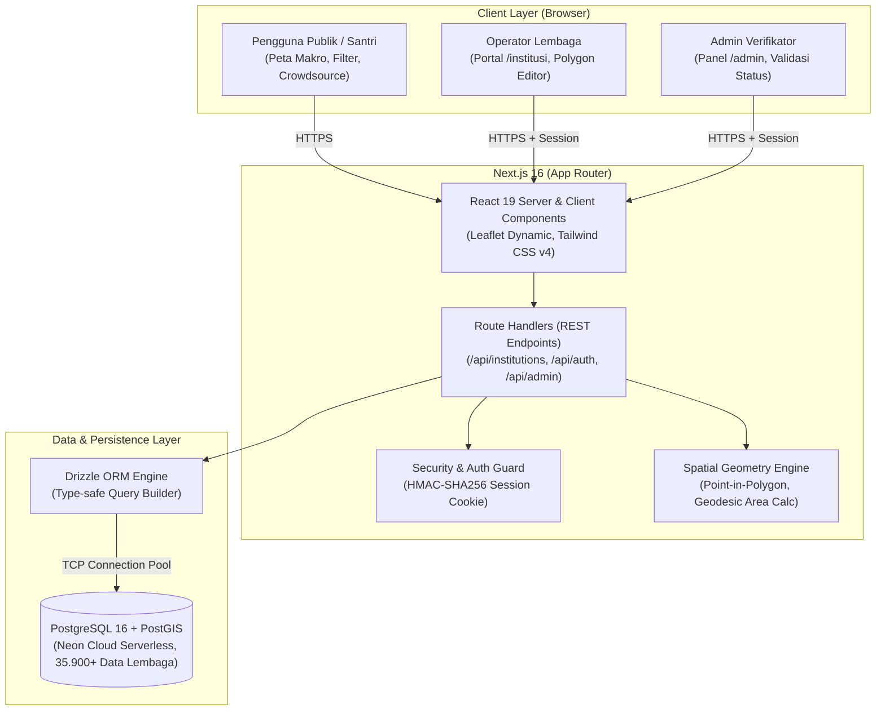
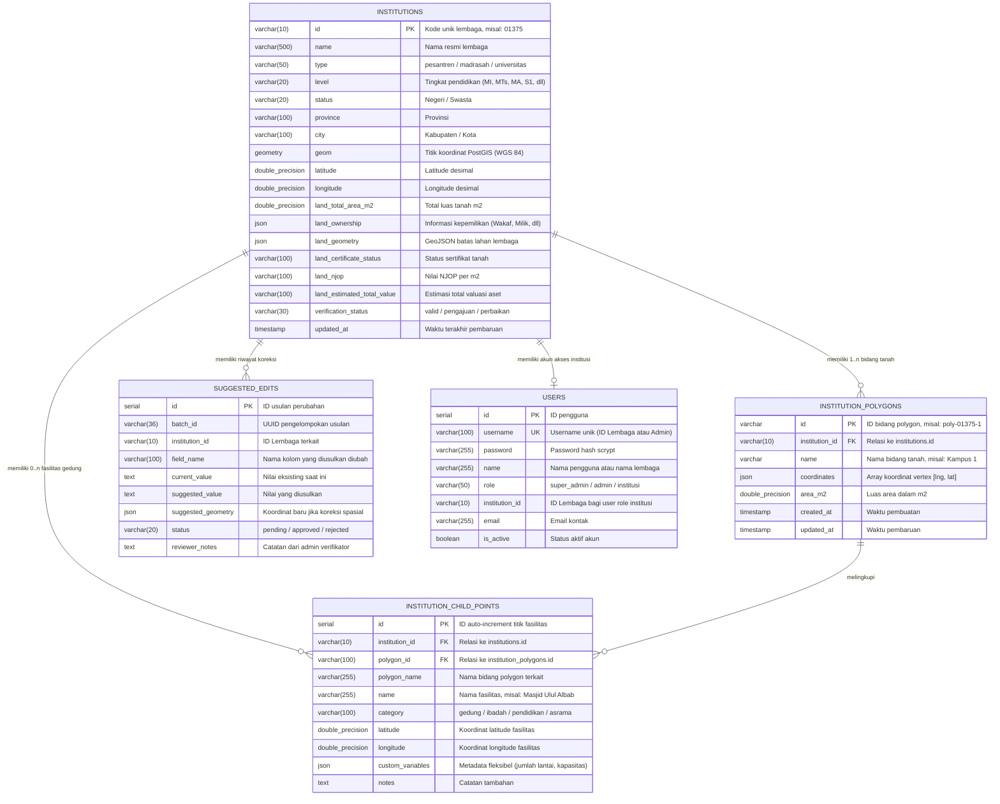
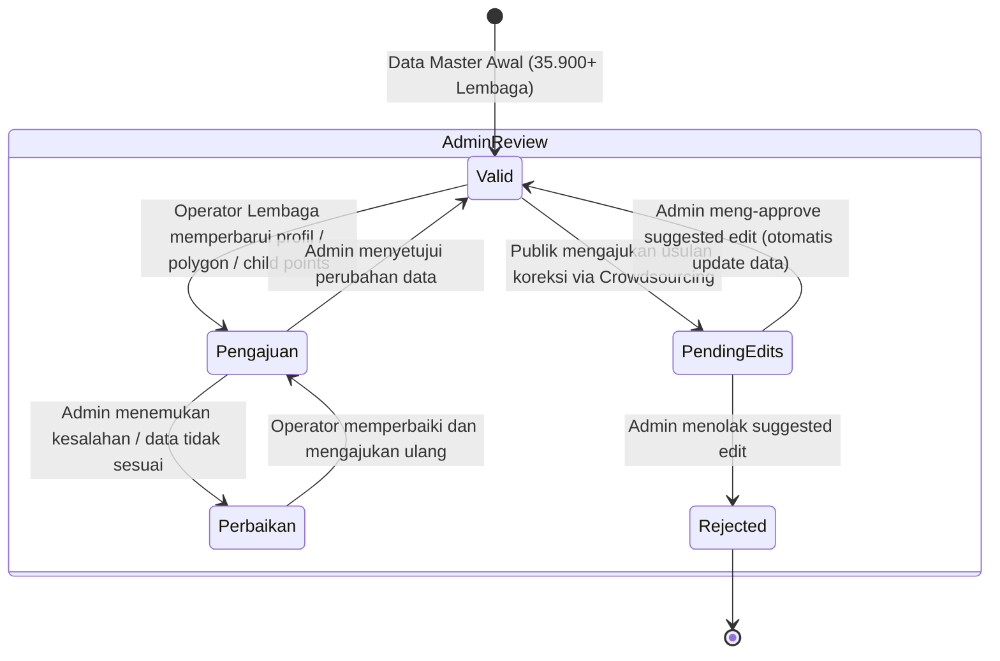
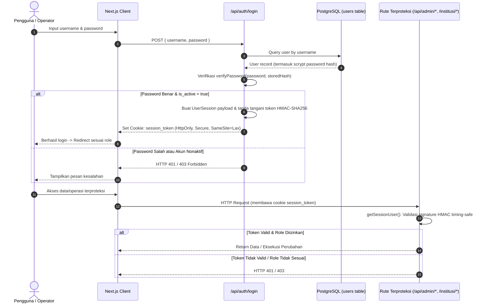

# Arsitektur Sistem & Spesifikasi Teknis — SIS-LPI Next
**Sistem Informasi Spasial Lembaga Pendidikan Islam (Next.js Edition)**

Dokumen ini mendefinisikan arsitektur sistem perangkat lunak, perancangan basis data, model spasial, alur verifikasi data, serta mekanisme keamanan pada **SIS-LPI Next**.

---

## 1. Tinjauan Arsitektur Tingkat Tinggi (High-Level Architecture)

SIS-LPI Next menerapkan arsitektur monolitik modular modern (*modern modular monolith*) berbasis **Next.js 16 (App Router)** dengan pemisahan tanggung jawab yang tegas antara lapisan presentasi, lapisan API/Route Handlers, modul domain spasial, dan lapisan persistensi data Drizzle ORM.

---

## 2. Lapisan Sistem (System Layers & Responsibilities)

### 2.1 Lapisan Presentasi (Presentation Layer)
- **Komponen Server (React Server Components)**:
  - Mengambil data awal secara efisien di server tanpa overhead pengiriman JavaScript client. Digunakan pada rute `/institutions/[id]` untuk optimasi SEO dan initial page load.
- **Komponen Klien (`"use client"`)**:
  - Peta Interaktif Leaflet (`MapContainer.tsx`, `MarkerCluster.tsx`, `PolygonMapEditor.tsx`, `MiniMap.tsx`).
  - Bilah Filter dan Pencarian Cerdas (`SearchFilterSidebar.tsx`).
  - Drawer rincian data dan formulir usulan perubahan (`InstitutionDetailDrawer.tsx`, `SuggestEditModal.tsx`).
- **Aturan Pemuatan Peta**: Seluruh modul yang bergantung pada Leaflet wajib dimuat dengan `next/dynamic` opsi `{ ssr: false }` untuk mencegah eksekusi pada lingkungan server Node.js.

### 2.2 Lapisan API & Rute Layanan (Route Handlers)
- Berada di dalam direktori `app/api/*`.
- Mengimplementasikan pola RESTful dengan validasi input tipe data dan penanganan kesalahan terpusat.
- Mengembalikan response JSON standar dengan status HTTP yang tepat (`200 OK`, `201 Created`, `400 Bad Request`, `401 Unauthorized`, `403 Forbidden`, `404 Not Found`, `500 Internal Server Error`).

### 2.3 Lapisan Domain & Mesin Spasial (Spatial Geometry Engine)
- Berada di [`lib/geometry.ts`](file:///D:/Abun/Projects/sis-lpi-next/lib/geometry.ts).
- Bertanggung jawab melakukan komputasi geometri:
  1. **Algoritma Point-in-Polygon (Ray-Casting Algorithm)**: Menentukan secara presisi apakah suatu koordinat titik fasilitas berada di dalam koordinat batas polygon lembaga.
  2. **Kalkulator Luas Poligon Geodesik**: Menghitung estimasi luas area bidang tanah dalam meter persegi ($m^2$) dengan mempertimbangkan kelengkungan bumi (proyeksi sferis).
  3. **Normalisasi Multi-Polygon**: Menstandarkan struktur format koordinat polygon (Multi-ring, sub-parcels, GeoJSON).

### 2.4 Lapisan Persistensi Data (Persistence Layer)
- Menggunakan **Drizzle ORM** yang bertipe aman (*strictly typed*).
- Menghubungkan aplikasi ke PostgreSQL melalui driver `pg` dengan pooling koneksi otomatis.
- Skema terpusat di [`lib/db/schema.ts`](file:///D:/Abun/Projects/sis-lpi-next/lib/db/schema.ts).

---

## 3. Model Data & Diagram Entitas (Entity-Relationship Diagram)

---

## 4. Alur Bisnis & Siklus Verifikasi (Verification State Machine)

Setiap entitas data lembaga memiliki siklus hidup verifikasi untuk menjamin akurasi dan akuntabilitas data spasial kelembagaan.

### Penjelasan Status:
1. **`valid`**: Data telah diperiksa dan disetujui. Ditampilkan secara publik sebagai data resmi terverifikasi.
2. **`pengajuan`**: Pihak institusi baru saja menyimpan pembaruan profil atau batas polygon/fasilitas. Data ini muncul di daftar antrean verifikasi Admin di `/admin/institutions`.
3. **`perbaikan`**: Admin mengembalikan pengajuan dengan catatan perbaikan (misal: "Dokumen sertifikat belum jelas" atau "Batas polygon terpotong jalan umum").
4. **`suggested_edits` (`pending` -> `approved` / `rejected`)**: Usulan koreksi dari masyarakat yang diproses melalui sistem perbandingan *diff view*.

---

## 5. Arsitektur Keamanan & Otentikasi (Security Architecture)

### Komponen Pengamanan Kunci:
1. **Hashing Password**: Menggunakan `crypto.scryptSync` dengan salt 16-byte acak dan panjang output 64-byte. Format penyimpanan: `<salt>:<hash>`.
2. **Mencegah Timing Attacks**: Pengujian kecocokan hash dan token signature menggunakan `crypto.timingSafeEqual` untuk mencegah kebocoran informasi melalui perbedaan waktu komputasi CPU.
3. **Penyimpanan Token Sesi**: Disimpan pada cookie HTTP yang aman dengan flag `SameSite=Lax` dan masa berlaku 7 hari.

---

## 6. Taksonomi Endpoint API (API Specification Matrix)

| Endpoint | Method | Autentikasi / Izin | Deskripsi & Tujuan |
| :--- | :---: | :--- | :--- |
| `/api/institutions/map` | `GET` | Publik | Payload ringan marker peta se-Indonesia (<300ms) dengan filter provinsi, tipe, status, jenjang. |
| `/api/institutions/polygons` | `GET` | Publik | Mengambil data poligon koordinat lahan institusi untuk dirender di atas peta Leaflet. |
| `/api/institutions/[id]` | `GET` | Publik | Profil detail lengkap institusi termasuk fasilitas, tanah, dan child points. |
| `/api/institutions/[id]/child-points` | `GET` | Publik | Daftar titik fasilitas gedung di dalam institusi. |
| `/api/institutions/[id]/child-points` | `POST` | Admin / Institusi Pemilik | Menambahkan titik fasilitas baru dengan validasi point-in-polygon wajib. |
| `/api/institutions/[id]/child-points/[pointId]` | `PATCH` | Admin / Institusi Pemilik | Mengubah atribut atau koordinat titik fasilitas. |
| `/api/institutions/[id]/child-points/[pointId]` | `DELETE` | Admin / Institusi Pemilik | Menghapus titik fasilitas gedung. |
| `/api/stats` | `GET` | Publik | Ringkasan statistik nasional: total lembaga, proporsi tipe, top provinsi. |
| `/api/provinces` | `GET` | Publik | Daftar provinsi unik dan jumlah lembaga per provinsi. |
| `/api/suggest-edit` | `POST` | Publik | Mengirim usulan koreksi data oleh masyarakat. |
| `/api/auth/login` | `POST` | Publik | Otentikasi multi-peran (Admin & Institusi). |
| `/api/auth/logout` | `POST` | Terautentikasi | Mengosongkan sesi cookie. |
| `/api/auth/me` | `GET` | Terautentikasi | Informasi identitas user aktif dan hak aksesnya. |
| `/api/institusi/me` | `GET` | Role `institusi` | Profil lembaga khusus milik institusi yang sedang login. |
| `/api/admin/institutions` | `GET` | Role `admin`, `super_admin` | Daftar institusi dengan filter status verifikasi (`valid`, `pengajuan`, `perbaikan`). |
| `/api/admin/institutions/[id]/status` | `PATCH` | Role `admin`, `super_admin` | Mengubah status verifikasi lembaga. |
| `/api/admin/edits` | `GET` | Role `admin`, `super_admin` | Daftar usulan crowdsource publik pending/approved/rejected. |
| `/api/admin/edits/[id]/approve` | `POST` | Role `admin`, `super_admin` | Menyetujui usulan koreksi dan mengaplikasikannya ke database. |
| `/api/admin/edits/[id]/reject` | `POST` | Role `admin`, `super_admin` | Menolak usulan koreksi dengan catatan reviewer. |
| `/api/admin/users` | `GET`, `POST` | Role `super_admin` | Manajemen akun pengguna (35.904 akun). |

---

## 7. Karakteristik Runtime & Kinerja (Runtime & Production Performance)

- **Next.js Turbopack & App Router**: Kompilasi aset dan rute super cepat.
- **Partial Prerendering (PPR)**: Halaman detail `/institutions/[id]` merender layout statis secara instan dan mengalirkan data dinamis (*streaming*) di background.
- **Neon Cloud Postgres Connection Pooler**: Menggunakan endpoint pooler (`-pooler`) untuk mencegah batas koneksi habis saat lalu lintas tinggi.
- **Keamanan Dependensi**: Next.js telah ditingkatkan ke **16.4.3** dengan konfigurasi `experimental.agentUpgrade = "security"` untuk menjamin keamanan dari kerentanan advisory terbaru.
