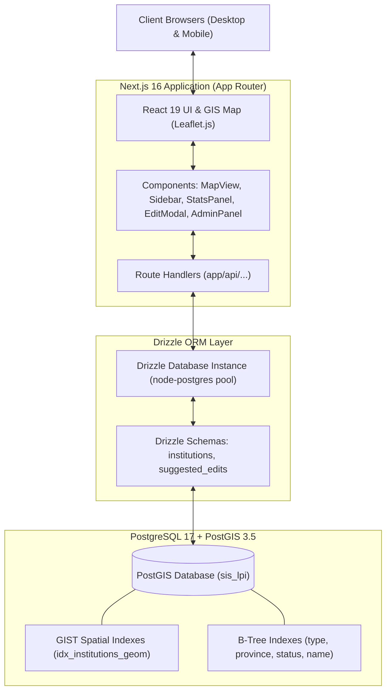

# System Architecture & Design Specification (Design.md)
**SIS-LPI Next: Modern Spatial Information System**

---

## 1. System Architecture Overview

---

## 2. Technology Stack & Framework Selection

| Layer | Technology | Rationale |
|---|---|---|
| **Frontend Framework** | **Next.js 16.4.0 (App Router)** | Rendering hybrid SSR/CSR, Server Actions, Route Handlers, Turbopack, dan integrasi terpadu |
| **UI Library & State** | **React 19.3.0** | Primitives modern, hooks optimistik, transisi async cepat |
| **Styling & Theme** | **Tailwind CSS v4** | Token utilitas CSS terkini, zero-runtime, kecepatan kompilasi maksimal |
| **Icons & Visuals** | **Lucide React** | Ikonografi modern, konsisten, dan ringan |
| **GIS / Mapping** | **Leaflet 1.9 + Marker Clustering** | Library GIS web standar industri; ringan, modular, kompatibel dengan tile provider OSM, Carto, Esri |
| **ORM & Data Access** | **Drizzle ORM (v1.0)** | Type-safe SQL query builder, nol overhead kompilasi, integrasi native PostgreSQL |
| **Database Driver** | **pg (node-postgres)** | Driver koneksi pooled resmi dan stabil untuk PostgreSQL di Node.js |
| **Database Engine** | **PostgreSQL + PostGIS** | Penyimpanan spasial poin lembaga, batas lahan poligon, dan indeks GiST spasial |

---

## 3. Database Schema Design (Drizzle ORM)

### 3.1 Tabel `institutions`
Menyimpan seluruh data lembaga pendidikan Islam, koordinat lintang/bujur, geometri PostGIS, dan atribut legalitas lahan.

| Kolom | Tipe Data | Deskripsi |
|---|---|---|
| `id` | `varchar(10)` | Primary Key (5-digit padded string / custom ID) |
| `name` | `varchar(500)` | Nama resmi lembaga (Not Null) |
| `type` | `varchar(50)` | Tipe (`pesantren`, `madrasah`, `universitas_islam`) |
| `level` | `varchar(20)` | Jenjang (`dasar`, `menengah`, `atas`, `tinggi`, `unknown`) |
| `status` | `varchar(20)` | Status kelembagaan (`negeri`, `swasta`) |
| `address` | `text` | Alamat jalan / lokasi detail |
| `province` | `varchar(100)` | Nama provinsi (e.g., "Jawa Timur") |
| `city` | `varchar(100)` | Nama kabupaten/kota |
| `latitude`, `longitude` | `doublePrecision` | Titik koordinat WGS84 untuk serialisasi cepat |
| `geom` | `geometry(Point, 4326)` | PostGIS Point geometry dengan indeks GiST |
| `coordinate_precision` | `varchar(30)` | Presisi koordinat (`exact`, `geocoded`, `city`, `polygon`) |
| `land_total_area_m2` | `doublePrecision` | Luas total tanah dalam meter persegi ($m^2$) |
| `land_ownership` | `json` | Array status kepemilikan (wakaf, hibah, milik sendiri) |
| `land_geometry` | `json` | GeoJSON polygon koordinat bidang tanah luar |
| `land_parcels` | `json` | Sub-bidang tanah dengan zonasi peruntukan |
| `land_certificate_status` | `varchar(100)` | Status SHM, Hak Pakai, Wakaf Terdaftar, dll. |
| `land_certificate_number` | `varchar(100)` | Nomor sertifikat tanah |
| `land_use_categories` | `json` | Kategori penggunaan lahan (pendidikan, ibadah, dll.) |
| `land_njop` | `varchar(100)` | Nilai Jual Objek Pajak |
| `land_price_per_m2` | `varchar(100)` | Estimasi harga pasar / NJOP per $m^2$ |
| `land_estimated_total_value` | `varchar(100)` | Estimasi total nilai aset tanah |
| `accreditation` | `varchar(100)` | Status akreditasi (A, B, C, Belum Terakreditasi) |
| `osm_tags` | `json` | Metadata tag OpenStreetMap |
| `source` | `varchar(20)` | Sumber data (`osm`, `emis`, `osm+emis`, `manual`) |
| `created_at`, `updated_at`| `timestamp` | Waktu pencatatan & modifikasi |

### 3.2 Tabel `suggested_edits`
Menampung pengusulan perbaikan dan penambahan lembaga dari publik sebelum disetujui admin.

| Kolom | Tipe Data | Deskripsi |
|---|---|---|
| `id` | `serial` | Primary Key auto-increment |
| `batch_id` | `varchar(36)` | UUID grouping untuk beberapa perubahan satu sesi |
| `institution_id` | `varchar(10)` | ID lembaga yang diedit (Null jika `action_type = 'create'`) |
| `institution_name` | `varchar(500)` | Nama lembaga terkait |
| `action_type` | `varchar(20)` | `update`, `create`, atau `delete` |
| `suggested_payload` | `json` | Payload lengkap untuk lembaga baru |
| `submitter_name` | `varchar(200)` | Nama pengusul |
| `submitter_role` | `varchar(100)` | Peran (Pengurus, Alumni, Santri, Warga) |
| `submitter_email` | `varchar(200)` | Email pengusul untuk konfirmasi |
| `field_name` | `varchar(100)` | Nama field yang diubah (e.g., "address", "coordinates") |
| `current_value` | `text` | Nilai awal |
| `suggested_value` | `text` | Nilai baru yang diusulkan |
| `suggested_geometry` | `json` | Koordinat atau poligon yang diusulkan |
| `status` | `varchar(20)` | `pending`, `approved`, `rejected` |
| `reviewer_notes` | `text` | Catatan dari admin verifikator |
| `reviewed_at`, `created_at`| `timestamp` | Timestamp verifikasi & pengajuan |

---

## 4. API Endpoints Architecture (Next.js Route Handlers)

Semua endpoint diimplementasikan di `app/api/...`:

- `GET /api/institutions/map`
  - Parameter: `province`, `type`, `status`, `level`, `accreditation`, `search`, `limit`
  - Return: Array ringkas untuk efisiensi transfer jaringan (< 100 bytes per marker)
- `GET /api/institutions/[id]`
  - Return: Objek detail lengkap lembaga termasuk legalitas tanah dan sub-parcels
- `GET /api/provinces`
  - Return: Daftar provinsi unik berurutan alfabetis
- `GET /api/stats`
  - Return: Agregasi total lembaga, distribusi per tipe, status, dan 10 provinsi terbanyak
- `POST /api/suggest-edit`
  - Payload: Pengajuan usulan perubahan atau pendaftaran lembaga baru
- `POST /api/admin/login`, `POST /api/admin/logout`, `GET /api/admin/session`
  - Autentikasi sesi berbasis cookie terenkripsi
- `GET /api/admin/edits`
  - Daftar usulan terkelompok berdasarkan `batch_id` dengan filter status
- `POST /api/admin/edits/[id]/approve` & `POST /api/admin/edits/[id]/reject`
  - Aksi verifikasi atomik per item
- `POST /api/admin/batch/[batchId]/approve` & `POST /api/admin/batch/[batchId]/reject`
  - Aksi verifikasi per batch sekaligus

---

## 5. UI/UX Design System & Layout Architecture

### 5.1 Color Palette (Modern Islamic GIS Palette)
- **Primary Accent (Emerald)**: `#059669` / `text-emerald-600` — Simbol identitas pendidikan Islam & Pondok Pesantren.
- **Secondary Accent (Amber/Orange)**: `#d97706` / `text-amber-600` — Identitas Madrasah.
- **Tertiary Accent (Indigo/Blue)**: `#4f46e5` / `text-indigo-600` — Identitas Perguruan Tinggi Islam.
- **Surface / Background**:
  - Light mode: Slate/Zinc 50 (`#f8fafc`) dengan border halus Zinc 200 (`#e2e8f0`).
  - Dark mode: Zinc 950 (`#09090b`) dengan panel Zinc 900 (`#18181b`).
- **Glassmorphism**: `backdrop-blur-md bg-white/90` untuk panel navigasi terapung di atas peta.

### 5.2 Layout Breakdown
1. **Peta Penuh Layar (Full-Height GIS Canvas)**:
   - Kontrol zoom dan pemilihan basemap (Satelit, OSM, Terang, Gelap).
   - Render cluster lingkaran dengan jumlah institusi.
2. **Floating Sidebar (Kiri)**:
   - Header aplikasi dengan branding SIS-LPI.
   - Input pencarian cepat dengan dukungan alias pintar (`uin`, `iain`, `ponpes`, dll.).
   - Tombol utama: "Usulkan Lembaga Baru".
   - Accordion filter: Kategori Layer, Filter Wilayah, Status & Akreditasi.
   - Widget mini-statistik: Ringkasan cepat jumlah titik aktif.
3. **Detail Drawer / Slide-Over (Kanan)**:
   - Jika pengguna mengklik marker di peta atau item dari pencarian, drawer meluncur halus dari kanan tanpa memutus konteks peta.
   - Menyediakan tautan ke halaman detail mandiri `/institutions/[id]`.
4. **Modal Pengusulan Perubahan**:
   - Tab pemilihan: Informasi Umum, Legalitas Tanah, dan Titik Koordinat.
   - Validasi interaktif sebelum pengiriman.
5. **Panel Admin Modern (`/admin`)**:
   - Tampilan berbasis kartu batch dengan indikator badge peran pengusul.
   - Visualisasi perbandingan (*before vs after*) warna hijau & merah.
